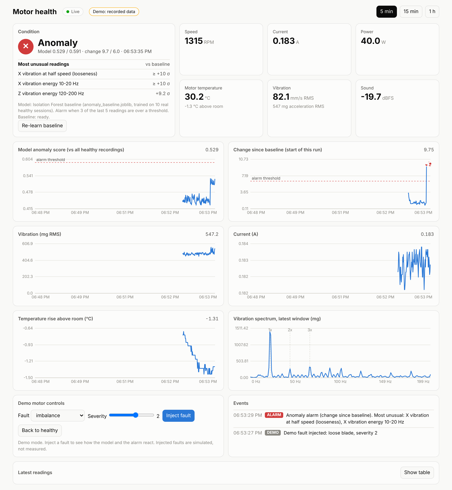

# Motor predictive maintenance

Live condition monitoring for a 230 V, 60 W ceiling-fan motor. An ESP32-S3 sensor node sends
vibration, rotation, current, speed, temperature and sound every 2 s. A Python service turns each
message into ~450 features, scores it with an anomaly model, and a web dashboard shows the readings
and the alarm live, on a PC or a phone.



```
 ESP32-S3 + sensors         Wi-Fi / MQTT            this PC
 (firmware/motor_node_v3) ───────────────▶ Mosquitto :1883 ──┬──▶ dashboard/server.py ──WebSocket──▶ browser (PC / phone)
  MPU6050 1 kHz bursts       topic                           │      features → model → alarm
  INMP441 16 kHz audio       motor/sensors                   │
  TCRT5000, PZEM-004T,       one ~28 KB JSON                 └──▶ pm/recorder.py ──▶ data/raw/<session>.jsonl ──▶ pm/train.py ──▶ models/
  DS18B20, DHT22             message / 2 s                          (labels)     └──▶ InfluxDB (optional)
```

The full data path, message format and every setting are in **[docs/DATA_PATH.md](docs/DATA_PATH.md)**.
How to plug in a new model: **[docs/MODEL_INTERFACE.md](docs/MODEL_INTERFACE.md)**.

| Folder / file | What it is |
|---|---|
| `firmware/motor_node_v3/` | ESP32-S3 sketch in use (v3: accel + gyro bursts at 1 kHz, raw audio, RPM ripple, PZEM). `motor_node_v2/` is the old one. |
| `pm/features.py` | turns one message into ~420 features (+ 34 trend features); the SAME code runs in training and live |
| `pm/recorder.py` | records labelled sessions to `data/raw/*.jsonl`, writes InfluxDB, optional live prediction |
| `pm/dataset.py`, `pm/train.py` | feature table from all sessions; Random Forest, XGBoost, Isolation Forest with leave-one-session-out evaluation |
| `dashboard/server.py` | the live dashboard (sources: demo motor, real MQTT, replay of a recording) |
| `dashboard/train_baseline.py` | trains the dashboard's baseline anomaly model on healthy sessions |
| `dashboard/check_connection.py` | checks that the ESP32's messages reach the PC and look right |
| `dashboard/publish_recording.py` | pretends to be the ESP32 (publishes a recording) to test without the rig |
| `dashboard/selftest.py` | offline test of features → model → alarm |
| `models/` | trained models. `anomaly_baseline.joblib` + `healthy_reference.json` come trained on the 10 healthy sessions of 7 Nov 2026 |
| `data/sample/` | two real recordings (s01 speed 1, s07 speed 3) for the demo and tests |

Commands are for **Windows** (cmd or PowerShell). On Linux/macOS use `source venv/bin/activate`,
`cp` instead of `copy`, and `/` in paths.

---

## Step 1. Install (once, ~10 minutes)

Python 3.10 to 3.13.

```
git clone https://github.com/kirthan156/major-motor-predictive-maintainence.git
cd major-motor-predictive-maintainence
python -m venv venv
venv\Scripts\activate
pip install -r requirements.txt
copy .env.example .env
```

All settings (broker address, data source, model) live in `.env`. Every setting can also be given as a
command-line flag; the flag wins.

Then check the PC side works, with no hardware:

```
cd dashboard
python selftest.py
```

Every line should say PASS. If `model loads` fails with a scikit-learn version error, rebuild the model
from your recordings: put the 10 sessions of 7 Nov (`s01_sp1.jsonl` ... `s14_sp1.jsonl`) in `data\raw\`
and run `python train_baseline.py` (30 s).

## Step 2. See the dashboard on the demo motor

```
cd dashboard
python server.py
```

Open http://localhost:8000.

- The badge **Demo: recorded data** means the readings are real recordings from the rig, played in a loop.
- Wait 1 minute while the baseline is learned (the subtitle says `baseline learning 12/30`).
- Under **Demo motor controls** pick a fault and a severity and press **Inject fault**. The change score
  crosses its threshold within a few readings, the state goes **Watch** then **Anomaly**, and
  *Most unusual readings* names what changed. **Back to healthy** returns it to normal.
- The injected faults are simulated changes on top of real data. They show how the dashboard reacts;
  they are not results. Never report detection numbers from them.
- Phone: connect it to the same Wi-Fi and open `http://<this PC's IPv4>:8000` (`ipconfig` shows the
  IPv4). Allow Python through Windows Firewall when asked.

## Step 3. Connect the real motor

### 3a. Start the MQTT broker (Mosquitto)

Install Mosquitto from https://mosquitto.org/download/. Create `C:\mosquitto\mosquitto.conf`:

```
listener 1883 0.0.0.0
allow_anonymous true
```

Run it in its own window and leave it open:

```
"C:\Program Files\mosquitto\mosquitto.exe" -c C:\mosquitto\mosquitto.conf -v
```

In Windows Defender Firewall, allow inbound **TCP 1883** on Private networks, or the ESP32 cannot reach it.
(If you installed Mosquitto as a service instead, `net start mosquitto` works, but the service ignores
your config and only listens on localhost unless you edit `C:\Program Files\mosquitto\mosquitto.conf`.)

### 3b. Flash firmware v3

1. Open `firmware/motor_node_v3/motor_node_v3.ino` in Arduino IDE.
2. Lines 34-36: your Wi-Fi name, password, and this PC's IPv4 (`ipconfig`) as `MQTT_BROKER`.
   Blank them again before you share the file.
3. Board **ESP32S3 Dev Module**, USB CDC On Boot **Enabled**, PSRAM **Disabled**. Libraries:
   MPU6050_light, OneWire, DallasTemperature, DHT sensor library, Adafruit SSD1306 + GFX, PZEM004Tv30, PubSubClient.
4. Upload. Serial Monitor (115200) prints a `Published #...` line every ~2 s and the OLED says `Sending ok`.

The PC's IPv4 can change after a restart or on another Wi-Fi. If messages stop, check `ipconfig` and re-flash.

### 3c. Check the connection

With the fan running:

```
cd dashboard
python check_connection.py
```

It listens for 30 s and prints PASS / WARN / FAIL for: broker, messages arriving, fields, firmware
version, ±8 g range, clipping, vibration burst (1024 samples at ~1 kHz), raw audio, feature extraction,
current, RPM, sound and temperatures. Fix every FAIL before going on.

No rig at hand? Test the same path with a recording standing in for the ESP32 (two terminals):

```
python publish_recording.py ..\data\sample\s01_sp1.jsonl
python check_connection.py
```

### 3d. Show live data

```
cd dashboard
python server.py --source mqtt
```

(or set `DASHBOARD_SOURCE=mqtt` in `.env`). The badge says **Live sensor (MQTT connected)**.

- Keep the motor healthy and at a fixed speed for the first minute: that is the baseline.
- After moving the speed regulator, press **Re-learn baseline** (the page reminds you when the speed
  differs from the baseline by more than 2 %).
- `pm/recorder.py` can run at the same time on the same broker (recording sessions or filling InfluxDB),
  because both just subscribe to `motor/sensors`.
- `--save-raw` also saves every message the dashboard receives to `data/raw/live_<time>.jsonl`.
- Every scored reading is logged to `dashboard/data/live_<time>.csv`.

## Step 4. Record more data

How to record sessions (labels, speeds, durations) is in [docs/recording-and-training.md](docs/recording-and-training.md).
The command is one line per run:

```
cd pm
python recorder.py --session s15_sp1 --label healthy --minutes 5 --notes "speed 1, day 2" --no-influx
```

Drop `--no-influx` when InfluxDB is running and its token is in `.env`. Sessions are saved to
`data/raw/<session>.jsonl`. To look at a recording on the dashboard:

```
cd dashboard
python server.py --source replay --file ..\data\raw\s15_sp1.jsonl --interval 0.5
python server.py --source replay --file ..\data\raw --loop          (every session in the folder)
```

## Step 5. Train on more data and switch the dashboard to it

```
cd dashboard
python train_baseline.py          (healthy-only Isolation Forest -> models\anomaly_baseline.joblib, 30 s)
cd ..\pm
python train.py                   (all models + leave-one-session-out reports in reports\, several minutes)
```

Restart the dashboard. With `DASHBOARD_MODEL=auto` it picks, in order: `models/best_anomaly.joblib` (the best model chosen by the Phase II code), `models/anomaly_iforest.joblib`
(from `pm/train.py`), the newest other `models/anomaly_*.joblib` / `.py` (for example the Phase II
models), then `models/anomaly_baseline.joblib`. The note under *Condition* shows which file is loaded.
To also show which fault a reading looks like (only once fault sessions exist):

```
python server.py --source mqtt --classifier ..\models\fault_rf.joblib
```

Then run `python selftest.py` again. Retrain when you add sessions or change the rig.

---

## How the alarm works

There are two scores; either one can raise the alarm.

| | Model score | Change since baseline |
|---|---|---|
| Compares the reading with | all healthy recordings the model was trained on | the first minute of this run |
| Good at | "this does not look like any healthy run we recorded" | a fault that starts while the motor runs |
| Blind to | small faults (healthy runs differ from each other more than a small fault changes them) | a fault already present when the baseline was learned |
| Threshold | 99th percentile of healthy sessions the model never saw (0.591 for the baseline model) | 6.0 (about 0.5 % of healthy readings over it on 7 Nov data) |

- **Watch**: the latest reading is over a threshold. **Anomaly**: 3 of the last 5 are (`--alarm-k`, `--alarm-n`).
  A single reading is not an alarm, because at a 1 % threshold a healthy motor still crosses it every ~3 minutes.
- *Most unusual readings* lists the features furthest from normal, in robust standard deviations. It
  points at the cause; it is not a diagnosis.
- Baseline model, held-out check on the 7 Nov sessions: 1.0 % of healthy readings over the threshold,
  0 % with the 3-of-5 alarm rule (`reports/baseline_anomaly.md`). There are no real fault recordings yet,
  so there is no measured detection rate. Do not claim one.

## Settings

| Flag | `.env` | Default | Meaning |
|---|---|---|---|
| `--source sim / mqtt / replay` | `DASHBOARD_SOURCE` | `sim` | demo motor, real ESP32, or a recording |
| `--file PATH` | `DASHBOARD_REPLAY` | | `.jsonl` file or folder for `replay` (`--loop` repeats) |
| `--model PATH` | `DASHBOARD_MODEL` | `auto` | anomaly model, `.joblib` or plugin `.py` |
| `--classifier PATH` | `DASHBOARD_CLASSIFIER` | none | fault classifier |
| `--threshold X` | `DASHBOARD_THRESHOLD` | from the model | override the model's alarm threshold |
| `--change-threshold X` | `DASHBOARD_CHANGE_THRESHOLD` | `6.0` | change-detector threshold |
| `--learn N` | `DASHBOARD_LEARN` | `30` | readings used to learn the baseline (30 = 1 min) |
| `--no-change` | | | turn the change detector off |
| `--broker`, `--port-mqtt`, `--topic` | `MQTT_BROKER`, `MQTT_PORT`, `MQTT_TOPIC` | `localhost`, `1883`, `motor/sensors` | MQTT |
| `--mqtt-user`, `--mqtt-password` | `MQTT_USER`, `MQTT_PASSWORD` | none | only if your broker needs a login |
| `--port` | `DASHBOARD_PORT` | `8000` | web port |
| `--interval S` | | `2` | seconds between demo or replayed readings |
| `--save-raw` | | off | save received messages to `data/raw/live_*.jsonl` |
| `--verbose` | | off | print every scored reading |

## Troubleshooting

| Symptom | Fix |
|---|---|
| Page says *Reconnecting* | `server.py` stopped. Look at its window for the error. |
| Page says *No new reading for N s* | The ESP32 stopped sending. Check the OLED (`NOT SENDING`?), Wi-Fi, and that Mosquitto is still running. |
| `--source mqtt`, badge says *MQTT disconnected* | Mosquitto is not running, or `MQTT_BROKER` in `.env` is wrong (on the PC itself it should be `localhost`). |
| Badge says *MQTT connected* but no data | Run `check_connection.py`. Usually the IPv4 in the `.ino` is out of date, or the firewall blocks TCP 1883, or Mosquitto listens on localhost only (add `listener 1883 0.0.0.0`). |
| An old reading appears the moment you connect | A retained message is stored on the broker. Clear it once: `mosquitto_pub -t motor/sensors -r -n` |
| Alarm right after changing speed | Expected: the change detector compares with the old speed. Press **Re-learn baseline**. |
| Alarms on a healthy motor with the model score | The motor or mount changed since training (or a new day/temperature). Record a few healthy sessions and retrain. |
| `WARNING: N/436 model features are missing` | The model was trained on a different firmware or feature version. Retrain it on v3 recordings. |
| `Message without a vibration burst skipped` | The ESP32 dropped one MPU6050 burst (I2C error). A few are normal; many mean loose SDA/SCL wires. |
| Current ~0.03 A or 0 | PZEM ring: live wire only, all 18 turns the same direction. See `docs/recording-and-training.md`. |
| Speed 0 RPM or jumping | TCRT5000 not seeing the taped stick. Tune its pot or move it closer. Speed is then estimated from vibration. |
| `ModuleNotFoundError` | Activate the venv (`venv\Scripts\activate`) and `pip install -r requirements.txt`. |
| Port 8000 already in use | Another dashboard is running. Close it or use `--port 8001`. |
