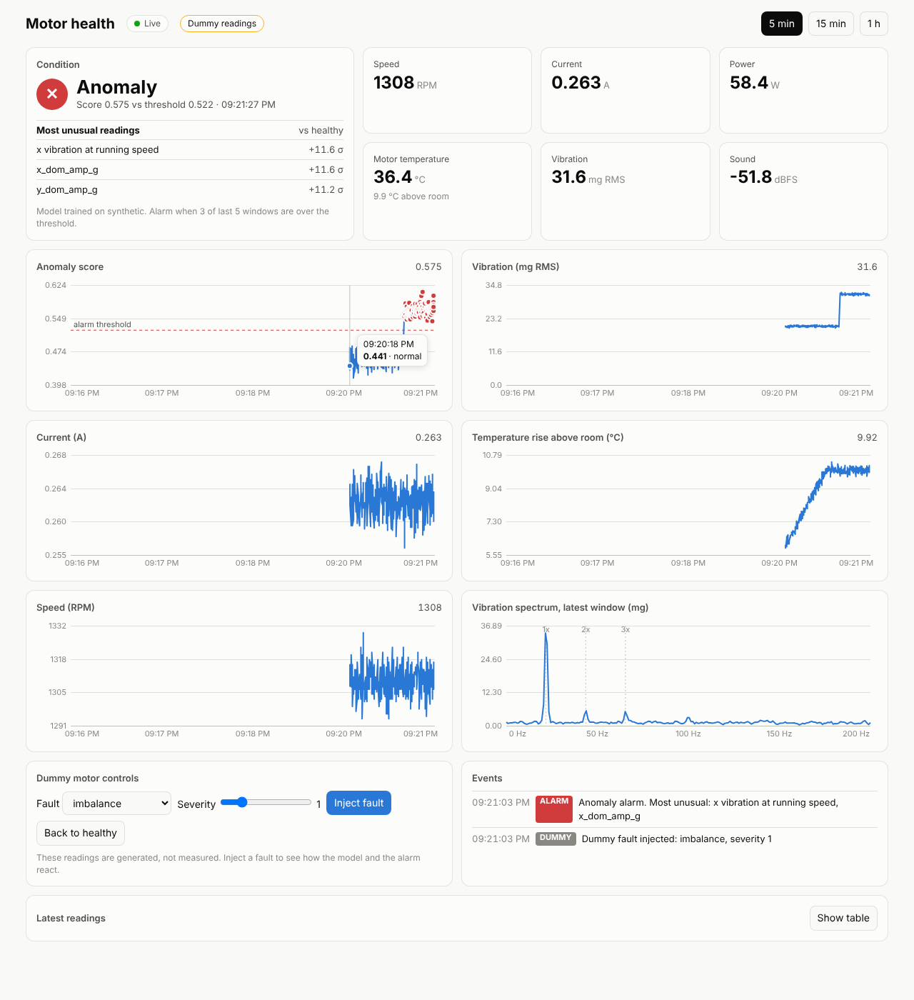

# Motor predictive maintenance

Live condition monitoring for a 230 V, 60 W table-fan motor. An ESP32-S3 sensor node sends vibration,
current, speed, temperature and sound readings every 2 s. A Python service turns each reading into
features and scores it with an anomaly model. A web dashboard shows the readings and the alarm live,
on a PC or a phone.



Until real data is recorded, the dashboard runs on a **dummy motor** that sends messages in exactly
the firmware's format. You can inject faults from the page. Switching to the real motor is one setting.

```
ESP32-S3 + sensors ──MQTT──> Mosquitto ──> dashboard/server.py ──WebSocket──> browser (PC / phone)
 (firmware/motor_node_v2)    (this PC)  └─> pm/recorder.py ──> data/raw/*.jsonl ──> pm/train.py ──> models/
```

| Folder | What it is |
|---|---|
| `firmware/motor_node_v2/` | ESP32-S3 sketch: 1 kHz vibration bursts + slow sensors, published to `motor/sensors` |
| `pm/` | `recorder.py` (record labelled sessions), `features.py`, `train.py` (fault classifier + anomaly model), `synthetic.py` |
| `dashboard/` | `server.py` (live dashboard), `check_connection.py` (tests the real data path), dummy motor, dummy model |
| `data/raw/` | recorded sessions, one `.jsonl` file per session (not pushed to GitHub) |
| `models/`, `reports/` | outputs of `pm/train.py` |
| `docs/recording-and-training.md` | how to record good data, train, evaluate, and fix the PZEM |

Commands below are for Windows (PowerShell or cmd). On Linux/macOS use `source venv/bin/activate`,
`cp` instead of `copy`, and `/` in paths.

---

## Step 1. Install (once)

Python 3.10 or newer.

```
git clone https://github.com/Kirthan156/Major-motor-predictive-maintainence.git
cd Major-motor-predictive-maintainence
python -m venv venv
venv\Scripts\activate
pip install -r requirements.txt
copy .env.example .env
```

All settings (broker address, data source, model) live in `.env`. Every setting can also be passed
as a command-line flag, and the flag wins.

## Step 2. Run the dashboard on dummy data

```
cd dashboard
python server.py
```

Open http://localhost:8000. The first start trains the dummy anomaly model (about 10 s).

- The **Dummy readings** badge means nothing is measured.
- Under **Dummy motor controls**, pick a fault (imbalance, loose blade, foot wedge, one-sided mount,
  air blockage) and a severity, then press **Inject fault**. The anomaly score crosses the threshold,
  the status goes to **Anomaly**, and *Most unusual readings* names what changed.
- Phone: connect it to the same Wi-Fi and open `http://<this PC's IPv4>:8000`. Run `ipconfig` to
  find the IPv4, and allow Python through Windows Firewall when asked.
- `python server.py --interval 0.5` speeds the dummy feed up for a demo.

## Step 3. Connect the real motor

### 3a. Start the MQTT broker (Mosquitto)

Install Mosquitto from https://mosquitto.org/download/. Create `mosquitto.conf` with:

```
listener 1883 0.0.0.0
allow_anonymous true
```

Then run it: `"C:\Program Files\mosquitto\mosquitto.exe" -c mosquitto.conf -v`. In Windows Defender
Firewall, allow inbound TCP port 1883 on Private networks, or the ESP32 cannot reach it.

### 3b. Flash the firmware

1. Copy `firmware/motor_node_v2/secrets.h.example` to `secrets.h` in the same folder. Fill in your
   Wi-Fi name and password, and set `MQTT_BROKER` to this PC's IPv4 from `ipconfig`.
   `secrets.h` is git-ignored, so the password is never pushed.
2. Arduino IDE board settings: **ESP32S3 Dev Module**, USB CDC On Boot **Enabled**, PSRAM **Disabled**.
3. Upload. The Serial Monitor (115200) should print a line every 2 s like
   `Published #12: 16384 bytes, vib fs=999.8 Hz rms=25 mg, I=0.2700 A, -52.0 dBFS, 1310 RPM`.

The PC's IPv4 can change after a restart. If messages stop, check `ipconfig` again and re-flash.

### 3c. Check the connection

With the fan running:

```
cd dashboard
python check_connection.py
```

It listens for 30 s and prints PASS / WARN / FAIL for: broker reachable, messages arriving, message
fields, vibration burst (1024 samples at about 1 kHz), feature extraction, current, RPM, sound and
temperatures. Each WARN or FAIL line says what to fix. Fix every FAIL before going on. The model
works with WARNs, but those sensors add nothing.

### 3d. Show live data

In `.env` set `DASHBOARD_SOURCE=mqtt`, or run:

```
python server.py --source mqtt
```

The badge now says **Live sensor (MQTT)**. The dashboard and `pm/recorder.py` can run at the same
time, because both just subscribe to the topic.

> **At this point the model is still the dummy one.** It has never seen your fan, so its alarms
> mean nothing yet. Steps 4 and 5 fix that.

## Step 4. Record real data

Each session is one physical setup, recorded for 3 to 5 minutes. Let the fan run about 2 minutes first.

```
cd pm
python recorder.py --session s01_healthy --label healthy --minutes 5 --no-influx
python recorder.py --session s02_imb1 --label imbalance --severity 1 --minutes 5 --no-influx --notes "1 coin taped to blade tip"
```

Labels: `healthy, imbalance, loose_blade, foot_wedge, one_sided_mount, air_blockage`, with severity 1 to 3
for faults. Drop `--no-influx` if InfluxDB is running and its token is in `.env`.
Sessions are saved to `data/raw/<session>.jsonl`.

**The anomaly model only needs healthy data.** Record at least 6 healthy sessions on different
days or after remounting the fan. Fault sessions are for the classifier and for measuring how well
the alarm works. The full recording plan is in [docs/recording-and-training.md](docs/recording-and-training.md).

To check a recording on the dashboard, replay it as if it were live:

```
cd dashboard
python server.py --source replay --file ..\data\raw\s02_imb1.jsonl
```

## Step 5. Train on real data and switch the dashboard to it

```
cd pm
python train.py
```

This writes `models/anomaly_iforest.joblib` (healthy-only anomaly model), `models/fault_rf.joblib`
(fault classifier, once fault sessions exist) and evaluation reports in `reports/`.

Restart the dashboard. With `DASHBOARD_MODEL=auto` (the default) it **automatically uses
`models/anomaly_iforest.joblib`** when that file exists. The model note under *Condition* shows which
file is loaded. To also show which fault a window looks like:

```
python server.py --source mqtt --classifier ..\models\fault_rf.joblib
```

Retrain whenever you add sessions or change the rig (new mount, new blade, sensor moved).

---

## How the alarm works

- An isolation forest learns what healthy windows look like. The score says how unusual a 2 s
  window is, and higher is worse. It uses the same features (`pm/features.py`) in training and live.
- Threshold: the 99th percentile of scores on healthy sessions the model did not train on.
- **Watch** means one window is over the threshold. **Anomaly** means 3 of the last 5 are
  (`--alarm-k`, `--alarm-n`). At a 1% threshold a healthy fan still crosses it about every 3 minutes,
  so a single window is not an alarm.
- *Most unusual readings* lists the features furthest from the healthy average, in standard
  deviations. It points at the cause but is not a diagnosis.
- Every scored window is logged to `dashboard/data/live_<time>.csv`.

## Dashboard options

| Flag | `.env` | Default | Meaning |
|---|---|---|---|
| `--source sim / mqtt / replay` | `DASHBOARD_SOURCE` | `sim` | dummy motor, real ESP32, or a recorded file |
| `--file PATH` | | | the `.jsonl` session for `replay` (add `--loop` to repeat) |
| `--model PATH` | `DASHBOARD_MODEL` | `auto` | anomaly model; `auto` = real model if trained, else dummy |
| `--classifier PATH` | `DASHBOARD_CLASSIFIER` | none | fault classifier from `pm/train.py` |
| `--broker`, `--port-mqtt`, `--topic` | `MQTT_BROKER`, `MQTT_PORT`, `MQTT_TOPIC` | `localhost`, `1883`, `motor/sensors` | MQTT settings |
| `--port` | `DASHBOARD_PORT` | `8000` | web port |
| `--interval` | | `2` | seconds between dummy or replayed readings |

## Troubleshooting

| Symptom | Fix |
|---|---|
| Dashboard says *Reconnecting* | `server.py` stopped; check its terminal for errors. |
| `--source mqtt` but no data | Run `check_connection.py`. Most often the IPv4 in `secrets.h` is out of date or the firewall blocks port 1883. |
| Current about 0.03 A | The PZEM ring is not seeing the current. See *PZEM current* in [docs/recording-and-training.md](docs/recording-and-training.md). |
| Speed 0 RPM | The TCRT5000 is not seeing the reflective mark. Speed is then estimated from vibration. |
| Alarms on a healthy fan with the real model | Record more healthy sessions (different days, after remounting) and retrain. |
| `ModuleNotFoundError` | Activate the venv (`venv\Scripts\activate`) and run `pip install -r requirements.txt`. |

## Honest limits

- The dummy motor and dummy model only show that the software works end to end. Their detection
  numbers say nothing about the real fan. Never report them as results.
- Even on dummy data, a mild one-sided mount (severity 1) is caught only about 10% of the time.
  Expect mild mounting faults to be the hardest on the real rig too.
